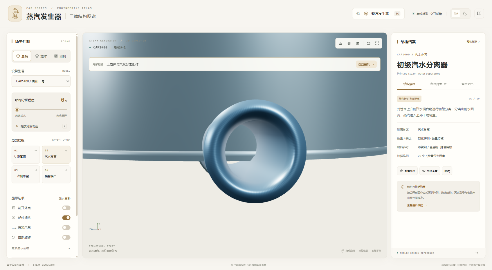
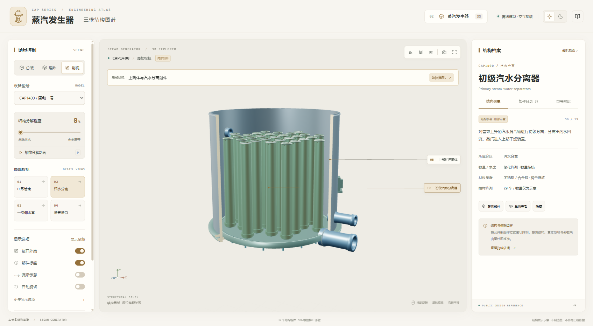
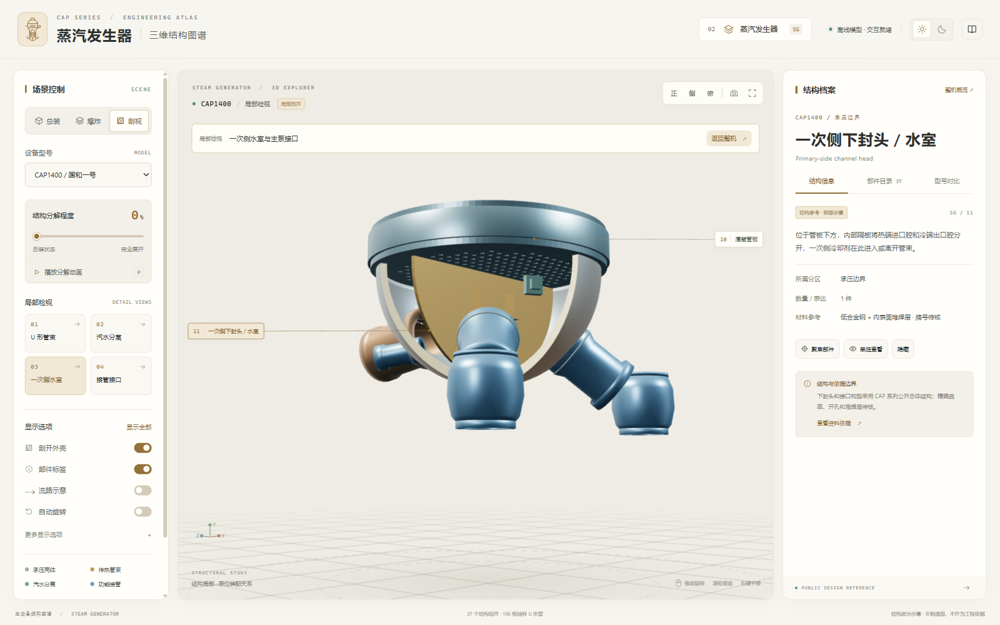

# 蒸汽发生器三维模型核查

日期：2026-11-18。范围：当前 CAP1400 与 CAP1000 两套模型，包含总装、剖视和局部检视。

**结论：存在实际建模问题。** 壳体开孔、管束与管板连接、分离器入口，以及水室隔板连接均有可复现的不一致。底部泵壳和分离器的外形还存在较明显的示意简化，影响整机观感。本轮保留原模型，只增加核查记录与截图。

## 已确认的问题

### 1. 接管后面仍有壳壁，部分开孔没有生成

优先级：高。

在未剖开的模型上，沿主给水、启动给水、下部水位计、二次侧人孔、管板区手孔的中心轴向内检查，都碰到了同侧壳体的内外表面。这些位置没有形成连续开口。水室人孔及排污口也存在壳壁遮挡；后两者没有加入对应的壳体开孔定义。

根因：`lib/model.js:120–133` 先生成回转壳，再根据三角形的**中心点**是否落入孔域删除整片三角形。圆柱壳的竖向边没有细分，一个三角形跨越数米高度；孔口虽与三角形相交，其中心却可能远离孔口，结果整片保留。这种方法也不能生成完整的孔壁和接管交线。

主给水还有第二重问题：接管中心高为 `transitionTop + 0.18`，而下部支撑环占据 `transitionTop + 0.10～0.22`，实体也横穿接管中心流道。只修壳体开孔仍不够。

定位：`lib/model.js:248–267`、`lib/model.js:260–261`、`lib/model.js:388–390`、`lib/model.js:431–437`。

建议：用能形成真实交线、孔壁的开孔方法；统一生成壳孔、接管和支撑件的边界，检查接管口截面是否贯通。

### 2. U 形管没有穿过管板，且管端被封闭

优先级：高。

| 检查项 | CAP1400 | CAP1000 |
|---|---:|---:|
| 管板下表面 Y，m | 2.8000 | 2.6000 |
| 管板上表面 Y，m | 3.6500 | 3.3914 |
| 管腿最低点 Y，m | 3.6500 | 3.3914 |
| 未表达的贯穿长度，m | 0.8500 | 0.7914 |

管板孔位与管腿在平面上对应，但管腿仅从管板上表面开始，没有延伸至下方水室。直管还使用了带端盖的实心圆柱几何；从水室沿抽样管孔向上检测，射线在管板上表面撞到管腿端盖。一次侧流路动画因此不能证明实体管道已连通。

定位：`lib/model.js:284–288`。

建议：把抽样管腿延伸穿过管板，用有管壁和开口的管道表达；U 弯与直管连接处也应保持连续。

### 3. 初级分离器入口被实心底盘封住

优先级：高。

分离器筒体本身采用开口圆柱，但底部另放了半径 `0.31 × nozzleScale`、厚 0.12 m 的封闭圆柱，遮住整个筒体入口。CAP1400 中，入口轴线上 Y=16.07～16.19 m 为这一实心圆盘；CAP1000 同样存在。

定位：`lib/model.js:344–346`。

建议：将底座改为留有入口的环形支承，并与支承板孔连通。外观方面，目前分离器被简化成约 4.5 m 高的直筒阵列，顶部只用少量板片表示；这会产生“排管”观感，但仅凭现有资料不能断定真实筒体高度错误。

### 4. 水室隔板与管板之间有约 20 mm 间隙

优先级：高。

隔板最高处为 `sheetY - 0.02`，管板下表面为 `sheetY`。两套模型的隔板上边缘均未接触管板。模型没有表示填补这条缝隙的连接或密封结构，与部件说明中“将热端与冷端水室分开”的表达不一致。

定位：`lib/model.js:393`。

建议：使隔板和管板形成连续的示意连接，再按图纸确定实际焊接、密封与补板形式。

### 5. 底部泵壳形态过于简化，缺少完整流道

优先级：中；对总装观感影响明显。

两只泵壳采用端部收至轴线的实心回转体，只加了上下环带，没有表示内部进水腔、完整出水接口或与下游冷段的连接。外观容易像悬挂在水室下的两个小罐体。

这不意味着可以删除两只泵壳：项目既有部件说明及制造计划索引都包含泵壳。问题在于外形和连接表达不足，不能由当前简化轮廓判断实际泵壳的正确比例及方位。

定位：`lib/model.js:406–417`。

建议：按泵壳外形资料重新建立外轮廓及接管连接，明确只显示泵壳还是整台主泵。

## 其他不一致

| 项目 | 实测/代码结果 | 处理建议 |
|---|---|---|
| 限流构件外缘 | 外半径 `0.35s`，出口内半径 `0.38s`，有 `0.03s` 径向空隙；未显示封闭空隙的结构 | 补充完整承载和密封边界，避免画出绕过限流孔的通道 |
| 管束支撑环与套筒 | 支撑环外缘比套筒内表面大 15 mm，存在实体重叠 | 明确支承接触关系，消除无意穿插 |
| 屏幕总包络 | 含泵壳的 CAP1400 总包络约 24.744 m，CAP1000 约 23.007 m | 区分模型坐标、壳体尺寸和附件包络；不直接与资料中不同口径的长度比较 |
| 一次侧流路线 | 使用独立曲线，没有绑定实际抽样管中心线；例如固定半径 1.20 m 不对应当前管排半径序列 | 如要声称“沿管内”，应从管束及接管的同一几何数据生成路径 |

## 已核对但不能据此下结论的事项

- 当前上、下筒体半径分别对应配置中的公开内径，未发现把直径误作半径的错误。
- 对照项目保存的 SNPTC 第 12 页图像，设备仍采用上部扩径、锥形过渡、下部管束和底部水室的总体布置。现有证据不足以判定所有分段高度、接口方位及内部件比例符合实机。
- 抽样管数、放大管径、分离器显示数量已在原说明中声明为显示选择，不把它们作为实机数量错误。
- 既有验证偏重交互、坐标有效性及爆炸组内相对位置；这些检查通过，不能排除本次发现的实体堵塞和连接问题。

## 核查依据与复现

- 模型：`lib/model.js`；参数：`lib/profiles.js`。
- 部件功能与资料边界：`docs/资料与建模说明.md`、`README.md`。
- 现有公开图像：`tools/reference-page12.png`。仅用于总体形态对照，未从图像反推制造尺寸。
- 核查脚本：`tools/model-audit-20261118/geometry-audit.cjs`。
- 原始结果：`docs/model-audit-20261118.json`。沿接口中心轴的射线只检测对应壳体，不把法兰、盖板等预期实体误计成壳体堵塞。
- 浏览器截图：`docs/previews/audit-*.png`。

建议修正顺序：**接管开孔及支撑环穿插 → 管腿贯穿与水室隔板连接 → 分离器入口 → 泵壳外形与连接 → 其他显示细节。**
